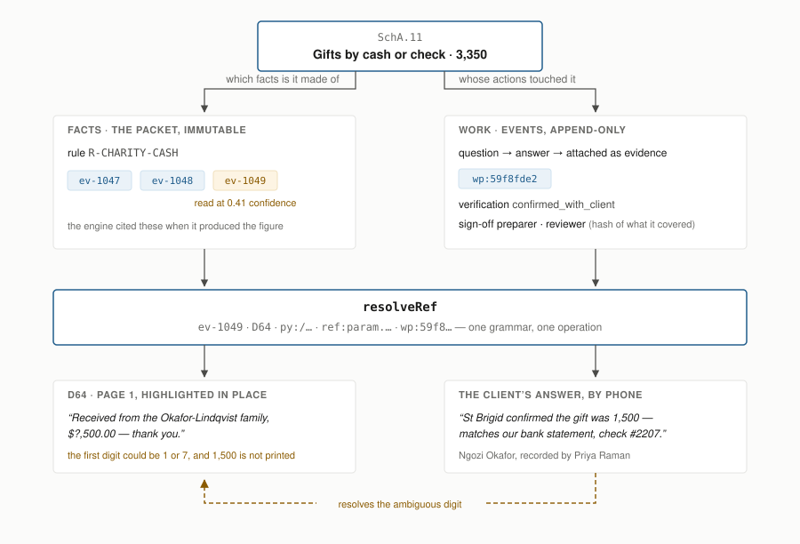
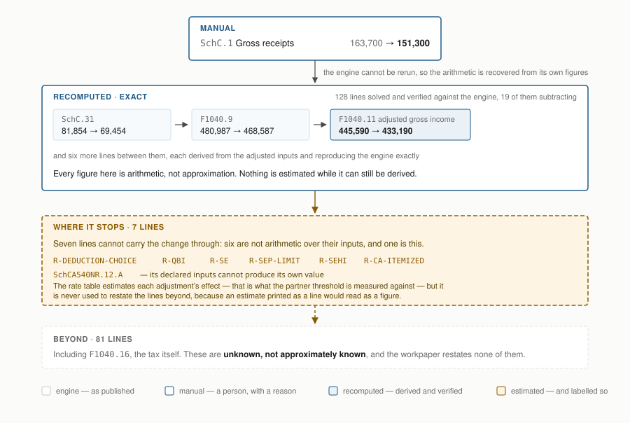

# The core idea, and the data model

## The idea

> A workpaper is not a spreadsheet. It is a **ledger**: an immutable fact layer,
> an append-only event layer, and views folded from the two on demand. Every
> number answers two questions — which facts is it made of, and whose actions
> have touched it.

Given the goals and no legacy, nobody builds a grid. The goals are *prove where
every number came from*, *show who checked it*, *show what is still open*, *keep
the original when something changes*, *reopen a signature when what was signed
moves*, *freeze at filing and amend on top*, *answer a notice years later*. Those
are not seven features. They are one shape — provenance plus an append-only
record — and a grid has neither.

Three decisions carry most of the system.

**One reference grammar, one resolver.** The packet addresses everything by short
strings in eleven formats: `ev-0035`, `D09`, `py:/basis_records/…`,
`asset:SAC-BLDG`, `ref:param.salt_cap`, `doc:D30#page32`, line keys. One parser
and one `resolveRef` mean every click-through in the app is the same operation,
and a reference that does not resolve is reported rather than swallowed. All
**8,691** references the packet uses parse; all **2,749** reference sites in the
current return resolve. When answers from the client needed to become evidence,
they got a reference in the same grammar — `wp:<id>` — and nothing else changed.

**Append-only, enforced by the database.** Triggers abort `UPDATE` and `DELETE`
on the events table. Undo is a compensating `revert` event, so the withdrawn
entry stays on the record. That single decision covers keeping the original,
showing what changed since you last looked, bulk undo, and freeze-then-amend,
without a mechanism for each.

**A sign-off stores a hash of what it covered** — the line's value and rule,
every line it is built from transitively, the extracted values underneath, and
the verifications and review notes standing at the time. Nothing has to be told
that a change happened. A change nobody anticipated still reopens the signature,
because the mechanism does not depend on anticipating it.

**Every number reaches its evidence two ways, and one resolver opens both.** The packet's
facts are immutable; the workpaper's events only ever append. Both produce references in the same
grammar, so a client's phoned-in answer opens exactly like a box on a Form W-2 — and here it is
what resolves a receipt whose first digit the pipeline could not read.

## The data model

**Fact layer** (`lib/graph/`) — read-only, indexed from the packet as delivered.
Nodes: documents, pages, extracted values, return lines, assets, prior-year
records, client answers, agency records, engine parameters. Edges: `sources`
(evidence), `inputs` (arithmetic), `supersedes`. Two indexes are the reverse of
what the packet stores and carry most of the product value — `linesByDoc` answers
*where did this document land*, `dependents` answers *what does this number feed*.

**Event layer** (`lib/events/`) — append-only, SQLite via Node's built-in
`node:sqlite`, no dependency. Verifications, notes, review notes that block
filing, questions and answers, citations, adjustments, approvals, sign-offs,
dismissals, sensitive-view log entries, filings, amendments. Every one carries an
actor the server decided from a cookie, never the client.

**Derived layer** — folds. The outline, the variance report, the check suite, the
adjusted return, the filing state, the notice record, the rollforward.

## The four kinds of number

The engine cannot be rerun, so an adjusted figure is one of four things and the
app says which beside it: **engine**, **manual**, **recomputed**, **estimated**.
The recomputation is not assumed — for each line that is arithmetic over other
lines, the combination reproducing the engine's published value is *solved for and
verified against it*: 128 lines, all 128 exact, 19 of them subtracting, because
`R-SUM` is documented as "arithmetic combination", not a sum.

**An adjustment is carried as far as recovered arithmetic allows, and no further.** The engine
cannot be rerun, so the combination behind each line is solved against the engine's own published
figures and verified. Where it cannot be recovered, propagation stops and the lines beyond are
reported as unknown rather than estimated into place.

## What it refuses to do

These are the design, not omissions.

- **It does not map Form 540 to Form 540NR.** The household moved mid-year; the
  forms share no line numbers; asserting a correspondence is a tax judgment. 19
  prior lines are reported unmatched with the reason.
- **It does not subtract across different subjects.** Schedule B assigns a line
  per payer, four payers became eight, so `SchB.1.3` names a different bank each
  year. Without that check the file would carry three confident false variances.
- **Propagation stops** at the five lines whose arithmetic cannot be recovered.
  Beyond them figures are unknown, not approximately known.
- **It does not total the findings.** One amount is gross income sourced to a
  state, another is a payment an agency has not posted. Adding them produces a
  number that looks like exposure and is not.
- **Replay is read-only**, because recording work against a past view is writing
  history.
- **The notice record includes the firm's own findings that contradict the
  return**, because an examiner will find the 1099-K double count anyway, and a
  record that hides it is worth less than one that explains it.

## The seam for real documents

`lib/graph/document.ts` is the only file that knows the source documents are
simulated. Everything above addresses evidence as "value `ev-0035` on page 1 of
`D09`" — what a real document store would also be asked for. Swapping in scans
means reimplementing `locatePage` against a text layer and real bounding boxes;
no caller changes. Measured today: **98.4%** of the 3,012 values locate on their
own printed page, by four strategies, and the app shows which one was used.
